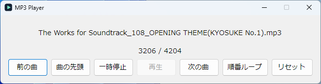

# MP3 Player

Windows 11 向けの小さな MP3 プレイヤーです。

## コンセプト

**iPod shuffle の精神で、曲を入れたら、あとは音楽におまかせ。**

エクスプローラーで聴きたい曲やフォルダーを選び、ウィンドウに放り込むと再生が始まります。普段は順番に流して、気分を変えたいときはシャッフル。気に入った曲はそのまま繰り返せます。そのとき聴きたい音楽を、少ない操作で流すためのプレイヤーです。

## 使い方



1. Windows 11 で配布用の `MP3Player.zip` を展開し、`MP3Player` フォルダーの `MP3Player.exe` を開きます。実行ファイルと同梱の DLL は同じフォルダーに置いてください。
2. MP3 ファイルやフォルダーをウィンドウにドラッグ＆ドロップします。フォルダーを指定すると、サブフォルダーも含めて MP3 を探します。
3. 最初に曲を追加すると自動で再生します。再生中に追加した曲は、今の曲を流したままリストの末尾に入ります。一度に追加した曲はファイル名順に並び、同じパスの曲は一度だけ登録されます。

再生モードのボタンを押すたびに、以下の順で切り替わります。

| モード | 動作 |
| --- | --- |
| 順番ループ | 登録順に再生し、最後まで聴くと先頭に戻ります。起動時のモードです。 |
| シャッフル | 全曲をランダムな順で一巡し、次の一巡で順番を選び直します。 |
| 1曲ループ | 現在の曲を繰り返します。「次の曲」を押すと、移動先の曲を繰り返します。 |

シャッフルを解除すると、今の曲を起点に登録順へ戻ります。たとえば19曲目を再生中なら、「前の曲」で18曲目、「次の曲」で20曲目へ移動します。順番ループでは、そのまま21曲目、22曲目と続きます。

「曲の先頭」で聴き直せます。「リセット」を押すと再生が止まり、曲と再生履歴が消去されます。アプリを終了すると曲のリストと再生モードは破棄されます。

コマンドプロンプトからは、MP3 ファイルやフォルダーを引数で渡せます。起動済みの場合は、そのウィンドウに曲が追加されます。

```cmd
MP3Player.exe "C:\Music\song.mp3" "D:\My Music"
```

各ボタンの詳しい動作は、同梱の[取扱説明書](doc/Readme.txt)をご覧ください。

## 実装

C# と Windows Forms で実装し、.NET Framework 4.8 をターゲットにしています。MP3 の読み込みと音声出力には NAudio 2.2.1 を使用します。

| ソース | 役割 |
| --- | --- |
| [MainForm.cs](src/MP3Player/MainForm.cs) | 画面、ドラッグ＆ドロップ、再生操作を担当します。NAudio の `AudioFileReader` で曲を読み込み、`WasapiOut` で出力します。再生に失敗した曲は飛ばして次へ進みます。 |
| [Mp3Paths.cs](src/MP3Player/Mp3Paths.cs) | ファイルとフォルダーを MP3 のパス一覧に展開し、ファイル名順に整列します。フォルダーの探索はスタックで行い、循環を防ぐため探索中に見つかったジャンクションやフォルダーのシンボリックリンクはスキップします。 |
| [PlaybackQueue.cs](src/MP3Player/PlaybackQueue.cs) | 登録順、現在の一巡で未再生の曲、再生履歴を分けて管理します。曲の前後への移動は、シャッフル中は再生履歴を、順番ループと1曲ループでは登録順を使います。曲番号はどのモードでも登録順です。 |
| [Program.cs](src/MP3Player/Program.cs) / [PathPipe.cs](src/MP3Player/PathPipe.cs) | 名前付きミューテックスで同一ユーザー・同一 Windows セッション内の多重起動を防ぎ、追加起動で受け取ったパスを名前付きパイプで既存のウィンドウに渡します。 |

### ビルドと配布

Visual Studio 2022 の「.NET デスクトップ開発」ワークロードと .NET Framework 4.8 ターゲットパックを用意し、[src/MP3Player.sln](src/MP3Player.sln) を開いてビルドします。依存パッケージは NuGet から復元されます。

配布用 ZIP を作るには、`dotnet` コマンドが使える環境で、リポジトリのルートから [Release.ps1](Release.ps1) を実行します。

```powershell
powershell.exe -NoProfile -ExecutionPolicy Bypass -File .\Release.ps1
```

Release ビルドの成果物と `doc/` の内容が、`out/MP3Player.zip` 内の `MP3Player/` にまとめられます。
